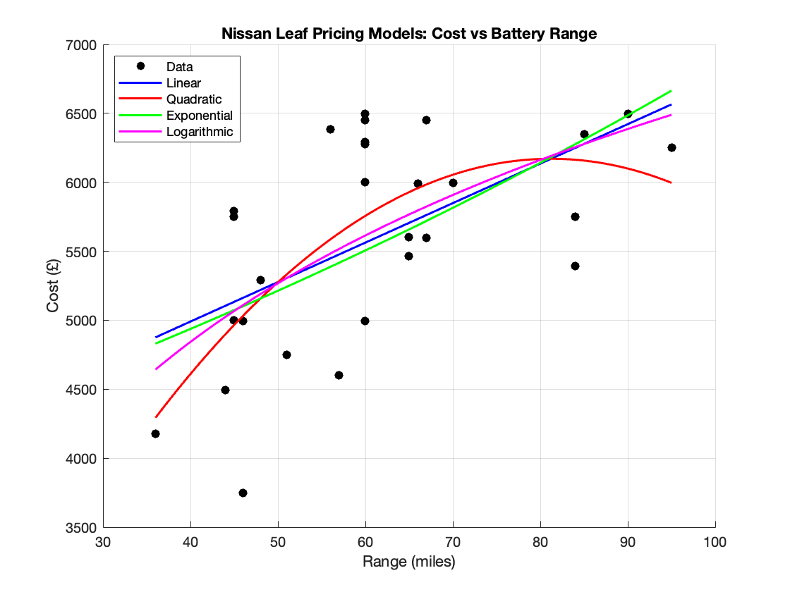

# Predicting used Nissan Leaf prices from battery range (MATLAB)

Project 2 from my Numerical Methods and Programming module. I updated to include my marker's feedback improvements.

Used cars are usually priced on mileage, but an electric car mostly loses value through battery wear. I wanted to see how well the remaining battery range predicts the price of a used Nissan Leaf, and whether it does better than mileage.

The data is 28 Nissan Leaf listings taken from AutoTrader on 7 September 2021 (`CarData.dat`).

## Methods

Least squares finds the line or curve that minimises the sum of the squared differences between the predicted and actual prices. I fitted four models of price against range:

- **Linear**, Cost = m\*Range + c. Setting the derivatives of the sum of squared errors with respect to m and c to zero gives two equations (the normal equations), which are solved for m and c.
- **Quadratic**, Cost = c0 + c1\*Range + c2\*Range^2. Each car gives one equation, so there are 28 equations and 3 unknowns. These are written as a matrix equation and solved in the least squares sense.
- **Exponential**, Cost = a\*exp(b\*Range). Taking logs gives ln(Cost) = ln(a) + b\*Range, which is a straight line, so it's fitted with the linear method.
- **Logarithmic**, Cost = m\*ln(Range) + c. This is a straight line in ln(Range), so it's also fitted with the linear method.

The models are compared using the RMSE (root mean squared error), which is roughly the typical prediction error in £.

## Files

- `extract.m`: loads the data
- `least_squares_linear.m`, `least_squares_quadratic.m`, `least_squares_exponential.m`, `least_squares_logarithmic.m`: fit each model
- `script_C.m`: fits all four models, prints the RMSE of each and plots them against the data
- `compare_mileage.m`: fits a straight line using range, mileage and year, to see which predicts price best

## How to run

Put all the files in the same folder and type these in the MATLAB command window:

```matlab
script_C
compare_mileage
```

## Results

| Model | RMSE |
|---|---|
| Linear | £616 |
| Quadratic | £571 |
| Exponential | £627 |
| Logarithmic | £595 |

The quadratic model has the lowest error, but it curves back down above about 80 miles, which would mean cars with more range are cheaper. That doesn't make sense, so I think it's partly fitting noise in a small dataset. These errors are also measured on the same data the models were fitted to. With more listings I'd keep some back and test the models on those.

Range does predict price better than mileage (RMSE of £616 against £659 for a straight line fit), but the car's year does better than both (£437). Newer Leafs tend to have bigger batteries, so some of what looks like a range effect is probably the age of the car.



## References

Numerical Methods and Programming lecture notes, University of Birmingham.
